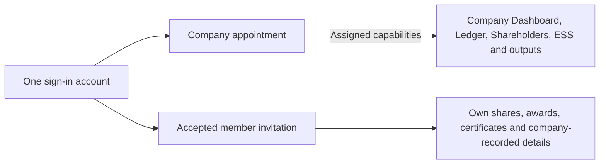
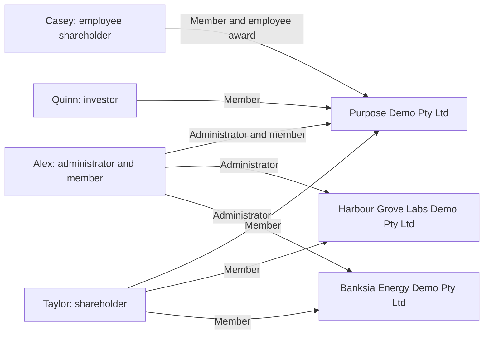

# Local demo accounts and handover

[Documentation](README.md) · [Local setup](getting-started.md)

These are intentionally published fictional **localhost-only** credentials, authorised by the
owner on 28 October 2026. They are not credentials for ledova.io. Real passwords, tokens, cookies
and runtime environment files stay outside Git.

Last credential verification: **27 October 2026** (Australia/Sydney). All four saved passwords
matched the local database hashes, with active sign-ins and verified email. This was a read-only
check; the handover update does not claim another password verification.

## Sign in

Open **http://localhost:5173/signin**. Sign out before using another account. Reuse the existing
local PostgreSQL database `ledova_walkthrough_20261021`; do not reset it or recreate accounts for
a fresh chat. A deliberate reset can invalidate these credentials and fixtures.

| Person              | Test role                             | Email                              | Password                                      | What to test                                                                 |
| ------------------- | ------------------------------------- | ---------------------------------- | --------------------------------------------- | ---------------------------------------------------------------------------- |
| Alex Demo           | Company administrator and shareholder | `director@purpose-demo.test`       | `5TASnw2RJQcPhZ-u-gXvbmF6nk0cRLVM`            | Company Dashboard, Ledger, Shareholders, ESS, Documents and Settings         |
| Taylor Demo         | Shareholder                           | `taylor@purpose-demo.test`         | `3anR1YOjxLrNKqm8U2QtP3j_IsU7jafd`            | My shares, member documents and company-recorded details                     |
| Casey Demo          | Employee shareholder                  | `casey@purpose-demo.test`          | `Q9NyOM_HQM_E2QxwgpvA9wzs2wXTQ9Mv`            | My shares, employee award records, certificates and company-recorded details |
| Quinn Investor Demo | Investor                              | `quinn.investor@purpose-demo.test` | `TwAFv-SU0E-nrW5je-idauWmZPly8-ZUcMXCTRJMVus` | My shares and investor certificate records                                   |

## What the account types mean

One sign-in can have different relationships with each company. An administrator appointment
permits company tasks within its capabilities; an accepted member invitation permits that person's
own records. Being a shareholder, investor or employee does not grant company administration.
An employee award is an entitlement; only an actual issue adds shares to holdings.



- **Alex Demo:** company administrator for three companies, and a member of Purpose Demo.
  This is the mixed-role example: one account, with independent company and personal access.
- **Taylor Demo:** shareholder/member in three companies; no company administration.
- **Casey Demo:** employee shareholder/member in Purpose Demo only, with an award and issued shares.
- **Quinn Investor Demo:** investor/member in Purpose Demo, for personal holdings and certificates;
  no company administration.

Other people in the ledger are records, not automatic sign-ins. Access to company-wide ownership
also depends on company sharing and current permissions.



### Fixture snapshot

Recorded 27 October 2026; use the running application for current balances and company status.

| Account     | Company                         | Issued shares held      |
| ----------- | ------------------------------- | ----------------------- |
| Alex Demo   | Purpose Demo Pty Ltd            | 7,900 ORD               |
| Taylor Demo | Purpose Demo Pty Ltd            | 100 ORD                 |
| Taylor Demo | Harbour Grove Labs Demo Pty Ltd | 1,500 ORD and 250 PRA   |
| Taylor Demo | Banksia Energy Demo Pty Ltd     | 5,000 ORD and 1,000 PRF |
| Casey Demo  | Purpose Demo Pty Ltd            | 250 ORD                 |

Alex's Purpose member access was linked through invitation and acceptance for #1360; matching a
display name alone grants no access. Taylor has three associations and Casey has one. Company
aggregate sharing is enabled for the local exercise. No genuine ABR check was fabricated.

## Current handover — 28 October 2026

- [PR #1382](https://github.com/Ledova/ledova/pull/1382) is merged at
  `e5bb1cb009d04677173c6d205e3c87d646db3341`. Dashboard has a top-right **Switch company**
  popover reusing the searchable picker, hidden for single-company accounts. The selected company
  stays in the sidebar footer. A single-company unavailable address has **Open your company**.
- Company-change confirmation, held-work blocks and company/account isolation remain in place.
  Switching from class details to a cached company keeps focus on the switch button; ordinary
  class exploration retains its own focus behavior. There is no workspace selector.
- [#1378](https://github.com/Ledova/ledova/issues/1378) holds this UI work and its completion
  records. Earlier PRs #1379–#1381 delivered compact filters, consistent page-header placement,
  flat lists and sidebar/layout cleanup. Follow the current
  [frontend standards](engineering/frontend.md) and [UX standards](engineering/frontend-ux.md).
- Exact-head independent review and all required CI passed for PR #1382:
  [CI run](https://github.com/Ledova/ledova/actions/runs/40623931028). Local source/client preflight
  passed dashboard **20** and browser smoke **9**, within the unchanged caps. Local backend
  verification stops at Python **3.13.15** (this Mac has **3.13.3**); CI runs the pinned suite.
- Chrome localhost displayed all three companies and checked mouse/Enter selection between Purpose
  and Banksia, nested Escape and cached-class focus with Alex. Existing cases exercise three-company
  switching, single-company hiding/recovery and
  dirty-form cancel/confirm. Local screenshots remain under
  `~/Developer/ledova-artifacts/web-filters-1378/`; they are not needed to run the app.
- No production deployment or database change was made. Keep mobile work for later and preserve
  Claude's unrelated worktrees. Remaining older issues include #624's deferred physical-device/
  human release acceptance and #1160's PyMuPDF adoption decision; check GitHub before resuming.

## Continue on this Mac

Use this repository copy of the guide; the former copy under `~/Developer/ledova-artifacts/` has
moved here. Pull current main, read AGENTS.md, CONTRIBUTING.md and the accepted plan/index before
new work. Reuse the running servers and database. Do not start another instance on an occupied port.

The dashboard normally runs at **http://localhost:5173** and the API at **http://localhost:8000**.
PostgreSQL must be running. If stopped, use separate terminals for the existing local launchers:

```sh
cd /Users/ronildo/Developer/ledova
/Users/ronildo/.local/state/ledova/web-walkthrough-20261021/.venv/bin/python /Users/ronildo/.local/state/ledova/web-walkthrough-20261021/walkthrough-server.py
```

```sh
cd /Users/ronildo/Developer/ledova
PATH=/Users/ronildo/.nvm/versions/node/v22.22.2/bin:$PATH VITE_API_URL=http://localhost:8000 npm run dev -w dashboard -- --host 127.0.0.1 --port 5173 --strictPort
```

The backend launcher uses its private local environment and invitation mailbox rather than external
email. Keep those runtime files, cookie jars and invitation links out of Git and public artifacts.
Keep `~/Developer/ledova-artifacts/` outside the repository and preserve unrelated evidence.
Update this guide if a local test password or scenario changes.
