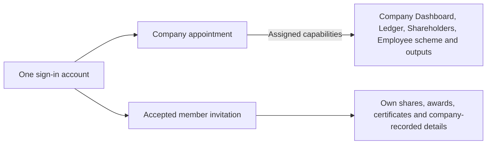
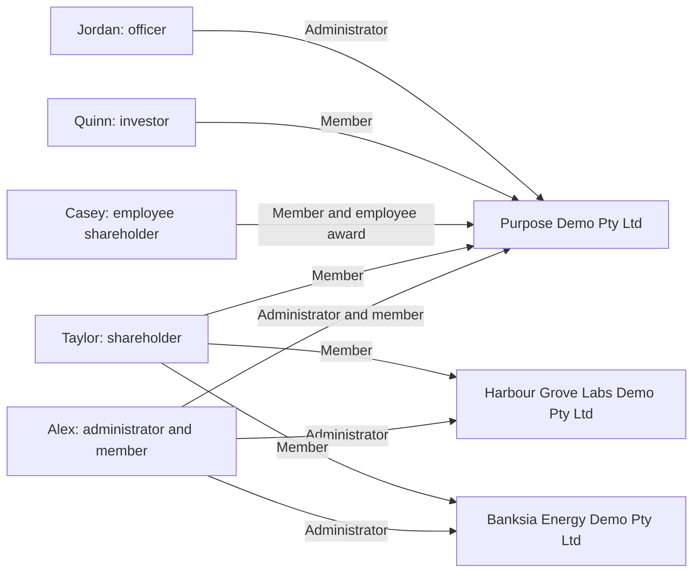

# Local demo accounts and handover

[Documentation](README.md) · [Local setup](getting-started.md)

These are intentionally published fictional **localhost-only** credentials, authorised by the
owner on 28 October 2026 (Jordan Ellis's on 29 October 2026). They are not credentials for
ledova.io. Real passwords, tokens, cookies and runtime environment files stay outside Git.

Last credential verification: **30 October 2026** (Australia/Sydney). All five accounts signed in
to the local API with these passwords.

## Sign in

Open **http://localhost:5173/signin**. Sign out before using another account. Reuse the existing
local PostgreSQL database `ledova_walkthrough_20261021`; do not reset it or recreate accounts for
a fresh chat. A deliberate reset can invalidate these credentials and fixtures. On 29 October 2026
it was rebuilt from #1421's fresh migrations with every record kept; the earlier copy is
`ledova_walkthrough_20261021_before_1421`.

| Person              | Test role                             | Email                              | Password                                      | What to test                                                                     |
| ------------------- | ------------------------------------- | ---------------------------------- | --------------------------------------------- | -------------------------------------------------------------------------------- |
| Alex Demo           | Company administrator and shareholder | `director@purpose-demo.test`       | `5TASnw2RJQcPhZ-u-gXvbmF6nk0cRLVM`            | Company Dashboard, Ledger, Shareholders, Employee scheme, Documents and Settings |
| Taylor Demo         | Shareholder                           | `taylor@purpose-demo.test`         | `3anR1YOjxLrNKqm8U2QtP3j_IsU7jafd`            | My shares, member documents and company-recorded details                         |
| Casey Demo          | Employee shareholder                  | `casey@purpose-demo.test`          | `Q9NyOM_HQM_E2QxwgpvA9wzs2wXTQ9Mv`            | My shares, employee award records, certificates and company-recorded details     |
| Quinn Investor Demo | Investor                              | `quinn.investor@purpose-demo.test` | `TwAFv-SU0E-nrW5je-idauWmZPly8-ZUcMXCTRJMVus` | My shares and investor certificate records                                       |
| Jordan Ellis        | Second Purpose Demo officer           | `jordan.ellis@purpose-demo.test`   | `sQS6zJDzdXdXO0SsAPCdksvL-kwhP42i`            | Purpose Demo Team and company authority                                          |

## What the account types mean

One sign-in can have different relationships with each company. An administrator appointment
permits company tasks within its capabilities; an accepted member invitation permits that person's
own records. Being a shareholder, investor or employee does not grant company administration.
An employee award is an entitlement; only an actual issue adds shares to holdings.



- **Alex Demo:** company administrator for three companies, and a member of Purpose Demo.
  This is the mixed-role example: one account, with independent company and personal access. At
  Purpose Demo his appointment also prepares and approves, so he decides eligibility requests there;
  at Banksia and Harbour he is an administrator only.
- **Taylor Demo:** shareholder/member in three companies; no company administration.
- **Casey Demo:** employee shareholder/member in Purpose Demo only, with an award and issued shares.
- **Quinn Investor Demo:** investor/member in Purpose Demo, for personal holdings and certificates;
  no company administration.
- Taylor, Casey and Quinn are active, identity-verified investors with eligibility claims.
- **Jordan Ellis:** a second Purpose Demo officer, added on 29 October 2026 to re-appoint Alex with
  prepare and approve.

Other people in the ledger are records, not automatic sign-ins. Access to company-wide ownership
also depends on company sharing and current permissions.



### Fixture snapshot

Recorded 27 October 2026; use the running application for current balances and company status.

| Account     | Company                         | Issued shares held      |
| ----------- | ------------------------------- | ----------------------- |
| Alex Demo   | Purpose Demo Pty Ltd            | 7,900 ORD               |
| Taylor Demo | Purpose Demo Pty Ltd            | 100 ORD                 |
| Taylor Demo | Harbour Grove Labs Demo Pty Ltd | 1,500 ORD and 250 PRA   |
| Taylor Demo | Banksia Energy Demo Pty Ltd     | 5,000 ORD and 1,000 PRF |
| Casey Demo  | Purpose Demo Pty Ltd            | 250 ORD                 |

Alex's Purpose member access was linked through invitation and acceptance for #1360; matching a
display name alone grants no access. Taylor has three associations and Casey has one. Company
aggregate sharing is enabled for the local exercise. No genuine ABR check was fabricated.

### Demo data, 29 October 2026

At the owner's request, more records were added so that pages are not empty. Two steps were made
directly in the local database through the backend's own services, because no identity provider runs
locally: Jordan Ellis's account was created, and Taylor, Casey and Quinn, already identity-verified
since 27 October, were made active. Every other record below went through the API as the real users.

- **Purpose Demo:**
  - Eligibility requests: Quinn's and Taylor's accepted, one of Casey's refused and two pending.
    The newest, which Casey sent with a later certificate after the refusal, carries Casey's name.
  - Member requests: Taylor's address change and certificate requests from Quinn and Casey.
  - A constitution, a shareholders agreement and financial statements under Supporting.
  - An inspection copy and a company pack.
- **Banksia:**
  - An allotment to a fund and a transfer to a family trust.
  - Two employee awards, one with its first tranche vested and issued.
  - A preference allotment entered as 2,500 shares, reversed by correction and recorded again as
    2,000.
  - An inspection copy and a company pack.
- **Harbour:** an allotment, a transfer and an employee award with its first tranche issued.
- Taylor's request to Banksia was withdrawn.
- The first inspection copies and packs predate #1429's record of where an output was produced, so
  they stay unlisted. A second copy and pack for each company, prepared after #1429, fill the lists.
- Published and Activity stay empty without the local chain.

## Current handover — 29 October 2026

- The signed-in web UX walkthrough under [#1378](https://github.com/Ledova/ledova/issues/1378) is
  finished. The owner steered it live in Chrome on localhost, and every change merged after an
  independent review at its exact head with green required CI.
  - **28 October:** class card filters (#1384) and oldest-first classes (#1385); last-used company
    at sign-in (#1389); the register CSV download removed, with inspection copies under Documents (#1390); and
    company documents in Documents, with recorded details on Profile (#1391).
  - **UX review in five phases:**
    - Phase 1 (#1392) removed record-details chevrons and internal IDs.
    - Phase 2 (#1393, #1394) gave lists visible actions and the employee award its own page.
    - Phase 3 (#1395–#1397) covered Member access and Team rows, and gave authority requests and
      offerings their own pages.
    - Phase 4 covered the share class chain area: Chain actions (#1400), condensed workflows
      (#1405) and Corrections' chain views (#1407).
    - After the owner's "Please continue until the end", the remaining company chevrons (#1411),
      phase 5's plain eligibility pages and wallet approvals (#1413), and the investor pages'
      content chevrons (#1415) followed.
- [#1416](https://github.com/Ledova/ledova/issues/1416) then gave Company eligibility, Offerings and
  Activity sidebar links, listed Published to your members under Documents and removed the web Market
  page with the client code only it used. The trading API is unchanged. At the owner's request sidebar
  items stay on one line: Employee scheme, Eligibility, Supporting and Published replace longer
  labels, and Supporting sits under Eligibility.
- [#1421](https://github.com/Ledova/ledova/issues/1421) takes offerings out of the first release. The
  web client went first (Offerings, Directory, Applications, paid issues and the large-investment
  claim), then the backend, with associated-person claims and account readiness. Verification now
  offers two claim categories and links Your company eligibility from Your claims.
  [Planned offerings](business/offerings.md) keeps their design.
- [#1424](https://github.com/Ledova/ledova/issues/1424) tidied the pages the owner found cluttered:
  - A company gives investors a request link instead of its Company ID.
  - Company eligibility lists requests first and picks the reviewer's appointment.
  - Corrections names changes by kind and date.
  - At the owner's choice, a request shares the investor's name with their consent (#1428), and
    Inspection copies and Company pack list what the company's own people prepared (#1429).
  - Eligibility request details no longer show internal IDs. They show the investor's name when the
    request shared one, and the investor sees the company's name when it is one of theirs.
- The rules the owner accepted are in [UX standards](engineering/frontend-ux.md):
  - Lists don't expand, and a record opens its own page or is a titled record.
  - There are no chevrons inside records, and long optional content sits behind `ShowMore`.
  - No internal IDs are shown. A short reference appears only where records would otherwise read
    the same or have no name. A company gives investors a request link instead of an ID.
  - `Disclosure` remains only for Activity's entries, Wallet shares' rows and Wallets' sort.
- **Process:**
  - A ruleset on `main` requires `Django verdict` and `PR type and issue` on a branch up to date
    with `main` ([decision](decisions.md#required-ci-and-auto-merge-on-main), #1409).
  - Auto-merge is turned on once the review passes. It stays on across pushes, so turn it off before
    any push other than a merge of `main` whose own changes are shown unchanged, and on again after
    the delta's review. Each merge is checked for tree and parent and recorded on its PR, and the
    owner is not asked to merge.
- **Checks:**
  - Local preflight passes dashboard **20** and browser smoke **9**, within the unchanged caps.
  - Local backend verification stops at Python **3.13.15** (this Mac has **3.13.3**), and CI runs
    the pinned suite.
  - Pages are checked against the demo data above. Before it was added, pages without local data
    were checked with sample API responses served in the browser only.
- **Branch previews:** run the branch's backend on **8040** and its dashboard on **5175** against the
  walkthrough database, with CORS and CSRF set to 5175, through configs in `.claude/launch.json`.
  The backend must run the branch's own code. Stop both when they are no longer needed.
- **Still open:**
  - Mobile work stays for later.
  - Older items include #624's deferred physical-device release acceptance and #1160's PyMuPDF
    decision; check GitHub before resuming.
- The walkthrough database was rebuilt and given demo data at the owner's request.
- [#1431](https://github.com/Ledova/ledova/issues/1431) rebuilt ledova.io on a fresh database on
  30 October 2026, serving main `90274b07`. At the owner's choice it kept no earlier test data, so
  it has no accounts until someone signs up. At the owner's request, every branch except `main`,
  every extra worktree and ledova.io's old data and backups were then deleted.

## Continue on this Mac

Use this repository copy of the guide; the former copy under `~/Developer/ledova-artifacts/` has
moved here. Pull current main, read AGENTS.md, CONTRIBUTING.md and the accepted plan/index before
new work. Reuse the running servers and database. Do not start another instance on an occupied port.

The dashboard normally runs at **http://localhost:5173** and the API at **http://localhost:8000**.
When no account can sign in, the API is usually not running: **http://localhost:8000/health/**
should answer `OK`. PostgreSQL must be running. If stopped, use separate terminals for the existing
local launchers:

```sh
cd /Users/ronildo/Developer/ledova
/Users/ronildo/.local/state/ledova/web-walkthrough-20261021/.venv/bin/python /Users/ronildo/.local/state/ledova/web-walkthrough-20261021/walkthrough-server.py
```

```sh
cd /Users/ronildo/Developer/ledova
PATH=/Users/ronildo/.nvm/versions/node/v22.22.2/bin:$PATH VITE_API_URL=http://localhost:8000 npm run dev -w dashboard -- --host 127.0.0.1 --port 5173 --strictPort
```

The backend launcher uses its private local environment and invitation mailbox rather than external
email. Keep those runtime files, cookie jars and invitation links out of Git and public artifacts.
Keep `~/Developer/ledova-artifacts/` outside the repository and preserve unrelated evidence.
Update this guide if a local test password or scenario changes.
