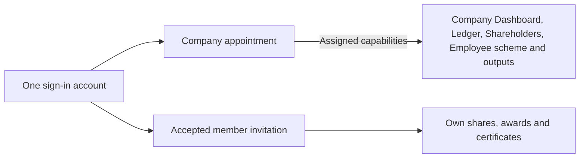
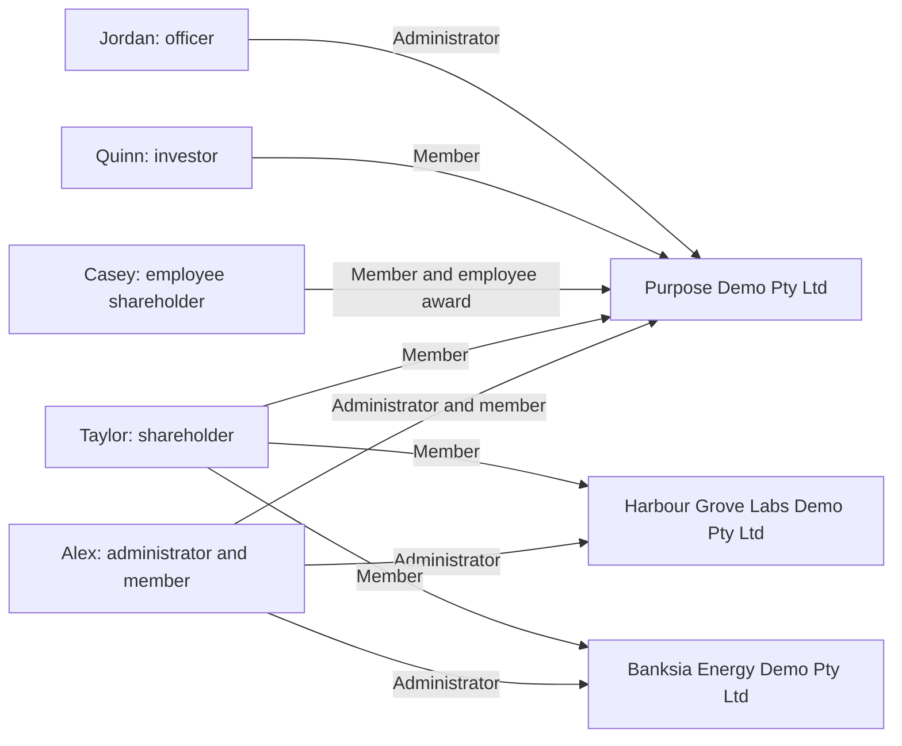

# Demo accounts and handover

[Documentation](README.md) · [Local setup](getting-started.md)

These are intentionally published fictional credentials. The owner authorised them for localhost on
28 October 2026 (Jordan Ellis's on 29 October 2026) and for ledova.io on 30 October 2026, accepting
that they are public ([#1435](https://github.com/Ledova/ledova/issues/1435)). Real passwords,
tokens, cookies and runtime environment files stay outside Git.

Last credential verification: **30 October 2026** (Australia/Sydney). All five accounts signed in
to the local API with these addresses and passwords, and ledova.io holds the same accounts.

## Where they work

| Where     | Sign in at                                     | Data                                                    |
| --------- | ---------------------------------------------- | ------------------------------------------------------- |
| This Mac  | **http://localhost:5173/signin**               | `ledova_walkthrough_20261021` in the local PostgreSQL   |
| ledova.io | **https://ledova.io/signin**, from any network | A copy of the local data and its files, made 30 October |

Both have the same five accounts and the same demo data as of 30 October 2026. They are separate
copies: a change in one does not reach the other. Neither has a platform staff account, and neither
sends email: messages such as invitations are saved to files, locally in the walkthrough's private
mailbox and on ledova.io on the server.

ledova.io has answered from any network since 30 October 2026
([#1437](https://github.com/Ledova/ledova/issues/1437)), so anyone who reads this guide can sign in
there and change the demo data or an account's password. Each account takes 10 sign-in attempts an
hour from everyone together, so give each person a different account.

## Sign in

Sign out before using another account. Locally, reuse the existing PostgreSQL database
`ledova_walkthrough_20261021`; do not reset it or recreate accounts for a fresh chat. A deliberate
reset can invalidate these credentials and fixtures. It was rebuilt from #1421's fresh migrations,
keeping every earlier record except what #1421 removed, and the demo data below was added again on
30 October 2026 (see the note there); the earlier copy is `ledova_walkthrough_20261021_before_1421`.

| Person              | Test role                             | Email                      | Password                                      | What to test                                                                     |
| ------------------- | ------------------------------------- | -------------------------- | --------------------------------------------- | -------------------------------------------------------------------------------- |
| Alex Demo           | Company administrator and shareholder | `director@ledova.io`       | `5TASnw2RJQcPhZ-u-gXvbmF6nk0cRLVM`            | Company Dashboard, Ledger, Shareholders, Employee scheme, Documents and Settings |
| Taylor Demo         | Shareholder                           | `shareholder1@ledova.io`   | `3anR1YOjxLrNKqm8U2QtP3j_IsU7jafd`            | My shares and member documents                                                   |
| Casey Demo          | Employee shareholder                  | `employee1@ledova.io`      | `Q9NyOM_HQM_E2QxwgpvA9wzs2wXTQ9Mv`            | My shares, employee award records and certificates                               |
| Quinn Investor Demo | Investor                              | `investor1@ledova.io`      | `TwAFv-SU0E-nrW5je-idauWmZPly8-ZUcMXCTRJMVus` | My shares and investor certificate records                                       |
| Jordan Ellis        | Second Purpose Demo officer           | `director@blueberry.money` | `sQS6zJDzdXdXO0SsAPCdksvL-kwhP42i`            | Purpose Demo Team and company authority                                          |

The addresses name each account's role, at the owner's domains ledova.io and blueberry.money.
Until 30 October 2026 they ended in @purpose-demo.test. They were then renamed in place on both
copies ([#1439](https://github.com/Ledova/ledova/issues/1439)), so each account kept its records
and password. Records the app never changes still hold the old addresses:

- a company's member access page lists each invitation's address and the address each member
  accepted with;
- authority requests keep the requester's details as recorded when made;
- the sample evidence files carry the address they were made with.

## What the account types mean

One sign-in can have different relationships with each company. An administrator appointment
permits company tasks within its capabilities; an accepted member invitation permits that person's
own records. Being a shareholder, investor or employee does not grant company administration.
An employee award is an entitlement; only an actual issue adds shares to holdings.



- **Alex Demo:** company administrator for three companies, and a member of Purpose Demo.
  This is the mixed-role example: one account, with independent company and personal access. At
  Purpose Demo his appointment also holds prepare and approve; at Banksia and Harbour he is an
  administrator only.
- **Taylor Demo:** shareholder/member in three companies; no company administration.
- **Casey Demo:** employee shareholder/member in Purpose Demo only, with an award and issued shares.
- **Quinn Investor Demo:** investor/member in Purpose Demo, for personal holdings and certificates;
  no company administration.
- Taylor, Casey and Quinn are active, identity-verified investors.
- **Jordan Ellis:** a second Purpose Demo officer, added on 29 October 2026 to re-appoint Alex with
  prepare and approve.

Other people in the ledger are records, not automatic sign-ins. Access to company-wide ownership
also depends on company sharing and current permissions.



### Fixture snapshot

Recorded 27 October 2026; use the running application for current balances and company status.

| Account     | Company                         | Issued shares held      |
| ----------- | ------------------------------- | ----------------------- |
| Alex Demo   | Purpose Demo Pty Ltd            | 7,900 ORD               |
| Taylor Demo | Purpose Demo Pty Ltd            | 100 ORD                 |
| Taylor Demo | Harbour Grove Labs Demo Pty Ltd | 1,500 ORD and 250 PRA   |
| Taylor Demo | Banksia Energy Demo Pty Ltd     | 5,000 ORD and 1,000 PRF |
| Casey Demo  | Purpose Demo Pty Ltd            | 250 ORD                 |

Alex's Purpose member access was linked through invitation and acceptance for #1360; matching a
display name alone grants no access. Taylor has three associations and Casey has one. Company
aggregate sharing is enabled in the demo data. No genuine ABR check was fabricated.

### Demo data, 29 and 30 October 2026

At the owner's request, more records were added so that pages are not empty. Two steps were made
directly in the local database through the backend's own services, because no identity provider runs
locally: Jordan Ellis's account was created, and Taylor, Casey and Quinn, already identity-verified
since 27 October, were made active. Every other record below went through the API as the real users.
ledova.io holds a copy of the same records and files, made on 30 October 2026.

- **Purpose Demo:**
  - Eligibility requests, each sharing the investor's name: Quinn's and Taylor's accepted, one of
    Casey's refused and two pending, the newer one sent with a later certificate after the refusal.
    `users/0003_remove_investor_eligibility` deletes them, with the investors' claims and evidence
    ([decision](decisions.md#verification-limited-to-id-checks)).
  - Certificate requests from Quinn and Casey, which `tokens/0005_remove_member_certificate_requests`
    deletes ([decision](decisions.md#member-certificate-requests-removed)).
  - A constitution, a shareholders agreement and financial statements under Company files, which
    `companies/0004_remove_company_documents` deletes with their files
    ([decision](decisions.md#company-documents-removed)).
  - An inspection copy and a company pack.
- **Banksia:**
  - An allotment to a fund and a transfer to a family trust.
  - Two employee awards, one with its first tranche vested and issued.
  - A preference allotment entered as 2,500 shares, reversed by correction and recorded again as
    2,000.
  - An inspection copy and a company pack.
- **Harbour:** an allotment, a transfer and an employee award with its first tranche issued.
- Taylor's eligibility request to Banksia was withdrawn; the same migration deletes it.
- Inspection copies and packs prepared before #1429 have no record of where they were produced, so
  they stay unlisted.
- Published stays empty without a chain.
- On 30 October 2026 the files of these records were lost: the walkthrough API had run from a
  worktree, and the uploads stored under its backend folder were deleted with it. The database was
  rebuilt from `ledova_walkthrough_20261021_before_1421`. The two direct steps were repeated with the
  same passwords, and every other record was added again through the API, so every record has its
  file. The walkthrough now runs from the main checkout, which holds its uploads.

## Current handover — 5 November 2026

Nothing is in flight: `main` holds everything, with no open pull request, other branch or worktree,
and neither #1464 nor #1453 is claimed. Check GitHub and claim an issue before starting it.

**Where things stand:**

- ledova.io serves main `a1ada30ee` for the backend, worker, dashboard and website, released on
  5 November 2026 with no migrations. The release record is in the private `Ledova/infra`. Nobody
  signed in for the release checks, so signed-in pages there are unconfirmed.
- The mobile app has not been released. It runs on the iOS simulator through Metro, and Android
  hasn't been checked.
- Since 31 October:
  - #1476 removed particulars and certificate requests, #1489 removed notices, #1491 kept only
    personal ID verification, and #1492 made a linked member's register details follow their
    profile.
  - [#1464](https://github.com/Ledova/ledova/issues/1464) rebuilt the app to match the web at phone
    width, including the company side.
  - The owner then walked through both platforms page by page as Taylor, Casey and Alex, on
    3–5 November. Pages became compact, Team and Account split, and the award's page and Change
    particulars were simplified further (#1557–#1559).
  - [#1547](https://github.com/Ledova/ledova/issues/1547) made the back arrow the only way back on
    every page with a parent (#1560).

**What's next, in order:**

1. [#1464](https://github.com/Ledova/ledova/issues/1464):
   - Phase 5, sign-up for company accounts. The app still tells them it is for shareholders.
   - A shareholder's supporting Documents section in the app.
   - Keeping held saves across leaving a page in the app, where leaving drops a retry, so a repeated
     add or invite could duplicate.
   - The other follow-ups: the review findings on #1529, and, in the issue's comments, the failed
     recipients read on Issue shares to them and the untested guards after preparing a transfer or
     setup.
2. [#1453](https://github.com/Ledova/ledova/issues/1453): the frontend architecture work the owner
   paused, including keeping open work mounted during a same-account recheck.
3. [#1555](https://github.com/Ledova/ledova/issues/1555): pagination, which the owner set aside for
   later. Ask before starting it.
4. Older items: #624's physical-device release acceptance and #1160's PyMuPDF decision.

**How the owner works:**

- The owner walks through pages and stops on each for feedback. "Make it compact too" means the
  pattern in [UX standards](engineering/frontend-ux.md) on the web and in the app: usually two lines,
  with the main figure or status at the right and one muted line of facts, and compact text actions
  at the right edge. "Looks good, next" means finish any open post-merge steps, then show the next
  page.
- Every UI change goes on both platforms and is checked on both, the web in Chrome's phone view and
  the app in the iOS simulator. Never change colours or fonts.
- Show the owner the result on both platforms before opening a PR for anything beyond the agreed
  pattern.
- Merge without asking once an independent review passes at the exact head and required CI is green.
  Record each review and merge on the PR, and delete the branch, worktree and temporary files
  afterwards.
- A release, a live migration, signer activation, real-funds use or a new cost needs the owner's
  explicit go, each time. Hosting procedures are in `Ledova/infra`.

**Traps found this round:**

- Independent reviews mostly blocked on stale documentation, not code. When a page changes, also
  search `docs/business` and the general rules in `docs/engineering`, such as tab titles and what the
  app's menu marks.
- In the app, `popTo` with no params clears the parent's params, which crashes a parent that needs
  them. Pass `keepParams` to `topBar`.
- A non-paid transfer hides its back arrow while a submission is unresolved, because its Cancel is
  locked then and the web's navigation blocker covers only Ledger and award pages.
- No test renders the app's `TopBar`, so its arrows and `held` need a live check.
- When Metro has run from a checkout, delete the generated, git-ignored `expo-env.d.ts` in `mobile/`
  before the checks. A reload signs the app out, and running the checks can cause one. After a branch
  switch, reload the app before judging a change.
- The walkthrough API doesn't reload and allows only origin 5173, so restart it after a backend change
  and preview a branch's dashboard on that port.

**Checks:**

- On this Mac run the checks with the walkthrough's Python:
  `make ci-checks PYTHON=/Users/ronildo/.local/state/ledova/web-walkthrough-20261021/.venv/bin/python`.
  They pass shared **9**, dashboard **20**, mobile **5**, contracts **14** and smoke **7**. Dashboard
  is at its cap of 20, so a new core test replaces another.
- With the same `PYTHON=`, `make preflight` stops at the backend suite, which needs Python **3.13.15**
  where this Mac has **3.13.3**. CI runs that suite.
- A ruleset on `main` requires `Django verdict` and `PR type and issue` on a branch up to date with
  `main`. Auto-merge pinned with `--match-head-commit` is the usual last step.
- A `Refs` pull request's commits must avoid closing keywords, so close the issue by hand once its
  work is done.

## Continue on this Mac

Use this repository copy of the guide; the former copy under `~/Developer/ledova-artifacts/` has
moved here. Pull current main, read AGENTS.md, CONTRIBUTING.md and the accepted plan/index before
new work. Reuse any running servers and the database. Do not start another instance on an occupied
port. The walkthrough servers are stopped between sessions; PostgreSQL, Redis and ClamAV run in Docker
(`docker start ledova-postgres-1 ledova-redis-1 ledova-clamav-local` after a restart).

The dashboard normally runs at **http://localhost:5173** and the API at **http://localhost:8000**.
When no account can sign in, check that the API answers: **http://localhost:8000/health/** should
return `OK`. PostgreSQL must be running. If the API or dashboard has stopped, start them in separate
terminals:

```sh
cd /Users/ronildo/Developer/ledova
/Users/ronildo/.local/state/ledova/web-walkthrough-20261021/.venv/bin/python /Users/ronildo/.local/state/ledova/web-walkthrough-20261021/walkthrough-server.py
```

```sh
cd /Users/ronildo/Developer/ledova
PATH=/Users/ronildo/.nvm/versions/node/v22.22.2/bin:$PATH VITE_API_URL=http://localhost:8000 npm run dev -w dashboard -- --host 127.0.0.1 --port 5173 --strictPort
```

For the app, start Metro the same way and open the dev client on the simulator:

```sh
cd /Users/ronildo/Developer/ledova/mobile
PATH=/Users/ronildo/.nvm/versions/node/v22.22.2/bin:$PATH EXPO_PUBLIC_API_URL=http://localhost:8000 EXPO_PUBLIC_MARKETING_URL=http://localhost:5176 npx expo start --dev-client --localhost --port 8081
```

The backend launcher uses its private local environment and invitation mailbox rather than external
email. Keep those runtime files, cookie jars and invitation links out of Git and public artifacts.
Keep `~/Developer/ledova-artifacts/` outside the repository and preserve unrelated evidence.
Update this guide if a demo password or scenario changes, locally or on ledova.io.
