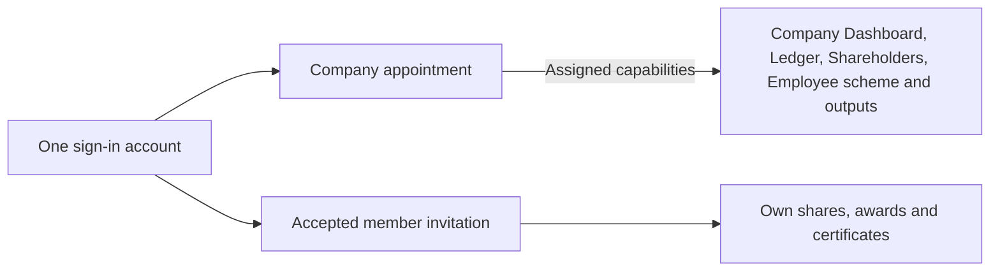
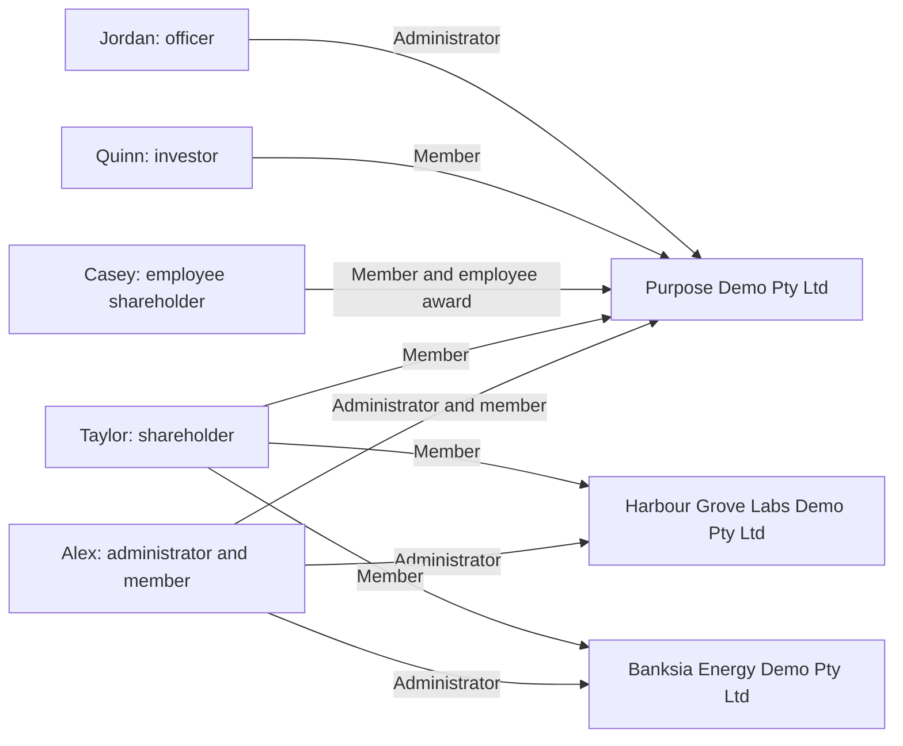

# Demo accounts and handover

[Documentation](README.md) · [Local setup](getting-started.md)

These are intentionally published fictional credentials. The owner authorised them for localhost on
28 October 2026 (Jordan Ellis's on 29 October 2026) and for ledova.io on 30 October 2026, accepting
that they are public ([#1435](https://github.com/Ledova/ledova/issues/1435)). Real passwords,
tokens, cookies and runtime environment files stay outside Git.

Last credential verification: **30 October 2026** (Australia/Sydney). All five accounts signed in
to the local API with these addresses and passwords, and ledova.io holds the same accounts.

## Where they work

| Where     | Sign in at                                     | Data                                                    |
| --------- | ---------------------------------------------- | ------------------------------------------------------- |
| This Mac  | **http://localhost:5173/signin**               | `ledova_walkthrough_20261021` in the local PostgreSQL   |
| ledova.io | **https://ledova.io/signin**, from any network | A copy of the local data and its files, made 30 October |

Both have the same five accounts and the same demo data as of 30 October 2026. They are separate
copies: a change in one does not reach the other. Neither has a platform staff account, and neither
sends email: messages such as invitations are saved to files, locally in the walkthrough's private
mailbox and on ledova.io on the server.

ledova.io has answered from any network since 30 October 2026
([#1437](https://github.com/Ledova/ledova/issues/1437)), so anyone who reads this guide can sign in
there and change the demo data or an account's password. Each account takes 10 sign-in attempts an
hour from everyone together, so give each person a different account.

## Sign in

Sign out before using another account. Locally, reuse the existing PostgreSQL database
`ledova_walkthrough_20261021`; do not reset it or recreate accounts for a fresh chat. A deliberate
reset can invalidate these credentials and fixtures. It was rebuilt from #1421's fresh migrations,
keeping every earlier record except what #1421 removed, and the demo data below was added again on
30 October 2026 (see the note there); the earlier copy is `ledova_walkthrough_20261021_before_1421`.

| Person              | Test role                             | Email                      | Password                                      | What to test                                                                     |
| ------------------- | ------------------------------------- | -------------------------- | --------------------------------------------- | -------------------------------------------------------------------------------- |
| Alex Demo           | Company administrator and shareholder | `director@ledova.io`       | `5TASnw2RJQcPhZ-u-gXvbmF6nk0cRLVM`            | Company Dashboard, Ledger, Shareholders, Employee scheme, Documents and Settings |
| Taylor Demo         | Shareholder                           | `shareholder1@ledova.io`   | `3anR1YOjxLrNKqm8U2QtP3j_IsU7jafd`            | My shares and member documents                                                   |
| Casey Demo          | Employee shareholder                  | `employee1@ledova.io`      | `Q9NyOM_HQM_E2QxwgpvA9wzs2wXTQ9Mv`            | My shares, employee award records and certificates                               |
| Quinn Investor Demo | Investor                              | `investor1@ledova.io`      | `TwAFv-SU0E-nrW5je-idauWmZPly8-ZUcMXCTRJMVus` | My shares and investor certificate records                                       |
| Jordan Ellis        | Second Purpose Demo officer           | `director@blueberry.money` | `sQS6zJDzdXdXO0SsAPCdksvL-kwhP42i`            | Purpose Demo Team and company authority                                          |

The addresses name each account's role, at the owner's domains ledova.io and blueberry.money.
Until 30 October 2026 they ended in @purpose-demo.test. They were then renamed in place on both
copies ([#1439](https://github.com/Ledova/ledova/issues/1439)), so each account kept its records
and password. Records the app never changes still hold the old addresses:

- a company's member access page lists each invitation's address and the address each member
  accepted with;
- authority requests keep the requester's details as recorded when made;
- the sample evidence files carry the address they were made with.

## What the account types mean

One sign-in can have different relationships with each company. An administrator appointment
permits company tasks within its capabilities; an accepted member invitation permits that person's
own records. Being a shareholder, investor or employee does not grant company administration.
An employee award is an entitlement; only an actual issue adds shares to holdings.



- **Alex Demo:** company administrator for three companies, and a member of Purpose Demo.
  This is the mixed-role example: one account, with independent company and personal access. At
  Purpose Demo his appointment also holds prepare and approve; at Banksia and Harbour he is an
  administrator only.
- **Taylor Demo:** shareholder/member in three companies; no company administration.
- **Casey Demo:** employee shareholder/member in Purpose Demo only, with an award and issued shares.
- **Quinn Investor Demo:** investor/member in Purpose Demo, for personal holdings and certificates;
  no company administration.
- Taylor, Casey and Quinn are active, identity-verified investors.
- **Jordan Ellis:** a second Purpose Demo officer, added on 29 October 2026 to re-appoint Alex with
  prepare and approve.

Other people in the ledger are records, not automatic sign-ins. Access to company-wide ownership
also depends on company sharing and current permissions.



### Fixture snapshot

Recorded 27 October 2026; use the running application for current balances and company status.

| Account     | Company                         | Issued shares held      |
| ----------- | ------------------------------- | ----------------------- |
| Alex Demo   | Purpose Demo Pty Ltd            | 7,900 ORD               |
| Taylor Demo | Purpose Demo Pty Ltd            | 100 ORD                 |
| Taylor Demo | Harbour Grove Labs Demo Pty Ltd | 1,500 ORD and 250 PRA   |
| Taylor Demo | Banksia Energy Demo Pty Ltd     | 5,000 ORD and 1,000 PRF |
| Casey Demo  | Purpose Demo Pty Ltd            | 250 ORD                 |

Alex's Purpose member access was linked through invitation and acceptance for #1360; matching a
display name alone grants no access. Taylor has three associations and Casey has one. Company
aggregate sharing is enabled in the demo data. No genuine ABR check was fabricated.

### Demo data, 29 and 30 October 2026

At the owner's request, more records were added so that pages are not empty. Two steps were made
directly in the local database through the backend's own services, because no identity provider runs
locally: Jordan Ellis's account was created, and Taylor, Casey and Quinn, already identity-verified
since 27 October, were made active. Every other record below went through the API as the real users.
ledova.io holds a copy of the same records and files, made on 30 October 2026.

- **Purpose Demo:**
  - Eligibility requests, each sharing the investor's name: Quinn's and Taylor's accepted, one of
    Casey's refused and two pending, the newer one sent with a later certificate after the refusal.
    `users/0003_remove_investor_eligibility` deletes them, with the investors' claims and evidence
    ([decision](decisions.md#verification-limited-to-id-checks)).
  - Certificate requests from Quinn and Casey, which `tokens/0005_remove_member_certificate_requests`
    deletes ([decision](decisions.md#member-certificate-requests-removed)).
  - A constitution, a shareholders agreement and financial statements under Company files, which
    `companies/0004_remove_company_documents` deletes with their files
    ([decision](decisions.md#company-documents-removed)).
  - An inspection copy and a company pack.
- **Banksia:**
  - An allotment to a fund and a transfer to a family trust.
  - Two employee awards, one with its first tranche vested and issued.
  - A preference allotment entered as 2,500 shares, reversed by correction and recorded again as
    2,000.
  - An inspection copy and a company pack.
- **Harbour:** an allotment, a transfer and an employee award with its first tranche issued.
- Taylor's eligibility request to Banksia was withdrawn; the same migration deletes it.
- Inspection copies and packs prepared before #1429 have no record of where they were produced, so
  they stay unlisted.
- Published stays empty without a chain.
- On 30 October 2026 the files of these records were lost: the walkthrough API had run from a
  worktree, and the uploads stored under its backend folder were deleted with it. The database was
  rebuilt from `ledova_walkthrough_20261021_before_1421`. The two direct steps were repeated with the
  same passwords, and every other record was added again through the API, so every record has its
  file. The walkthrough now runs from the main checkout, which holds its uploads.

## Current handover — 7 November 2026

Read current GitHub claims and pull requests before editing. This is a dated handover, not a
replacement for the issues or the [engineering standards](engineering/README.md).

**Delivered and checked:**

- The signed-in web review covered company, investor and employee/member journeys. Its bounded
  fixes are merged: Add person draft retention (#1570), common action/heading alignment (#1571),
  import wording and in-flight confirmation (#1572), identity-check error handling (#1573), the
  invited-company destination (#1574), Activation review retention (#1575), and unapplied
  Certificates filter retention (#1576). Existing regression cases were extended within their caps.
- Chrome checks on localhost at `aba54eeab` used real tab switches after the five-minute identity
  freshness window. Certificates retained its unapplied choices; Activation retained the exact
  open review form. Private content was briefly withheld during rechecking, with the frame intact
  and no repeated flicker or page reload. The declaration stayed unchecked and no activation was
  submitted; checked-acknowledgement retention is covered by the existing automated case.
- The last observed ledova.io dashboard release is `aba54eeab`, on 7 November. Company-account
  checks confirmed Purpose Demo's existing Active status and Certificates filtering and draft
  retention after real tab switches. No new activation or certificate was submitted; member-only
  Certificates were not exercised in production. Backend and site source/build inputs were
  unchanged from the 5 November release at `a1ada30ee`, so their existing artifacts remained.
  No migrations or backup operations ran. Release procedures and receipts stay in private
  `Ledova/infra`.
- Source main has since advanced through Claude's #1577–#1582 to `1ee5d4f51`: native error/access
  wording, simpler Certificates, shared sign-in/sign-up presentation, unused-code removal,
  native button/dialog cleanup and shared client logic. These newer commits are distinct from
  the production revision above; this handover does not claim they have been deployed.

**Ownership and what remains:**

1. [#1567](https://github.com/Ledova/ledova/issues/1567) tracks Claude's Settings, Documents,
   public/auth pages, shared page kit and native parity. Preserve Claude's checkout and check its
   latest claim before touching those paths. Dashboard, Ledger, Shareholders and Employee scheme
   remain coordinated under [#1453](https://github.com/Ledova/ledova/issues/1453). This wrap-up
   changes documentation only and releases its documentation claim when merged.
2. The owner requested a layout assessment, not implementation. At `aba54eeab`, Activation and
   Certificates matched Dashboard, Ledger, Shareholders and Profile in workspace width, alignment,
   typography and card styling. Keep the shared frame and page-heading filter placement.
   Claude's #1578 has already removed the repeated Can prepare text and visible entry numbers;
   do not implement those suggestions again.
3. Recheck these remaining layout proposals against current main and agree the visual direction
   before editing: a more compact Activation status summary; standard responsive spacing inside
   its review; one selected-record summary during certificate preparation, without repeating its
   shares and dates; and removal of the extra divider below preparation actions. Preserve distinct
   company and ledger dates, retained audit facts, current authority and request recovery.
   The extra divider comes from collection row dividers remaining while other rows are hidden;
   retain the mounted rows and the normal action separator.
4. Broader cleanup candidates and cache/guard ideas belong on #1567 and #1453. Re-verify callers
   before removing anything; this pass authorises no global cache rewrite or new navigation model.
   Keep mobile work for Claude/later in this continuation: use
   [#1464](https://github.com/Ledova/ledova/issues/1464) and the separately scoped native identity
   verification [#1562](https://github.com/Ledova/ledova/issues/1562), without claiming either complete.
5. [#1555](https://github.com/Ledova/ledova/issues/1555) pagination remains deferred pending the
   owner's direction. [#624](https://github.com/Ledova/ledova/issues/624) needs later human/device
   release acceptance; the PDF licensing replacement is recorded in
   [legal position 12](legal/positions.md#12-pymupdf-an-agpl-runtime-dependency).

**Resume safely:**

- Keep useful local evidence outside Git under `~/Developer/ledova-artifacts/`. The 6 November full
  web review and draft-retention folders hold the dated observations and checks; the 7 November
  layout-review folder holds measurements and screenshots of the assessed revision. These are
  evidence, not uncommitted application changes or proof about later source revisions.
- Use the demo accounts above and the local startup instructions below. Reuse running services;
  preserve the shared walkthrough database, uploads and other agents' processes. Do not delete
  another agent's checkout merely because its branch has merged. Do not reset data for a handover.
- Read fresh Chrome state before acting. Certificate action labels changed in #1578, so older
  entry-number locators and screenshots are historical. Upload and download through the server as
  the owner requested; retain private files and authentication material outside Git.
- Run `make preflight` before pushing. The last completed source/client preflight executed shared
  **9**, dashboard **20**, mobile **6**, contracts **14** and smoke **7** cases. Reconfirm counts on
  the new head; dashboard remains at its 20-case cap. Existing cases must be replaced, or an explicit
  cap increase approved, before adding a core case at capacity.
- The walkthrough Python is **3.13.3**; local backend verification stops at its **3.13.15** pin.
  Record that boundary on the PR and require backend CI. Do not report the local preflight as fully
  passed. Use the pinned Node/npm environment from [local setup](getting-started.md).
- Follow the usual focused PR, exact-head independent review, green current-with-main CI and
  squash merge workflow in [CONTRIBUTING.md](../CONTRIBUTING.md). No direct main pushes.
  A new live deployment, migration, signer activation, real-funds use or cost needs owner direction.

## Continue on this Mac

Use this repository copy of the guide; the former copy under `~/Developer/ledova-artifacts/` has
moved here. Pull current main, read AGENTS.md, CONTRIBUTING.md and the accepted plan/index before
new work. Reuse any running servers and the database. Do not start another instance on an occupied
port. The walkthrough servers are stopped between sessions; PostgreSQL, Redis and ClamAV run in Docker
(`docker start ledova-postgres-1 ledova-redis-1 ledova-clamav-local` after a restart).

The dashboard normally runs at **http://localhost:5173** and the API at **http://localhost:8000**.
When no account can sign in, check that the API answers: **http://localhost:8000/health/** should
return `OK`. PostgreSQL must be running. If the API or dashboard has stopped, start them in separate
terminals:

```sh
cd /Users/ronildo/Developer/ledova
/Users/ronildo/.local/state/ledova/web-walkthrough-20261021/.venv/bin/python /Users/ronildo/.local/state/ledova/web-walkthrough-20261021/walkthrough-server.py
```

```sh
cd /Users/ronildo/Developer/ledova
PATH=/Users/ronildo/.nvm/versions/node/v22.22.2/bin:$PATH VITE_API_URL=http://localhost:8000 npm run dev -w dashboard -- --host 127.0.0.1 --port 5173 --strictPort
```

For the app, start Metro the same way and open the dev client on the simulator:

```sh
cd /Users/ronildo/Developer/ledova/mobile
PATH=/Users/ronildo/.nvm/versions/node/v22.22.2/bin:$PATH EXPO_PUBLIC_API_URL=http://localhost:8000 EXPO_PUBLIC_MARKETING_URL=http://localhost:5176 npx expo start --dev-client --localhost --port 8081
```

The backend launcher uses its private local environment and invitation mailbox rather than external
email. Keep those runtime files, cookie jars and invitation links out of Git and public artifacts.
Keep `~/Developer/ledova-artifacts/` outside the repository and preserve unrelated evidence.
Update this guide if a demo password or scenario changes, locally or on ledova.io.
