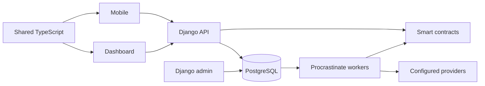

# Engineering

[Documentation](../README.md)

How Ledova's software is built: the parts of the system, the principles every change follows, and
where each area's structure and conventions are written. It is for engineers; the business rules
the software enforces are in [business processes](../business/README.md). Product settings and
application administration are in [operations](../operations/README.md); all deployment procedures
belong in private [Ledova/infra](https://github.com/Ledova/infra).

## System overview

The dashboard and mobile client call one Django API. Django stores application records in
PostgreSQL and queues background work through Procrastinate. Workers and operator actions
communicate with the chain and configured providers. Smart contracts enforce the share cap and
each company's whitelist, with expiry, on both sides of a transfer. Django admin is the operator
interface.

Redis supplies request quotas and trading events; it does not run the job queue. Private storage
and the scanner are required for uploaded evidence. The diagram shows the main relationships, not
every synchronous provider call.

The [company-managed register plan](../plans/company-managed-registers/plan.md) is the
accepted direction, and the [implementation index](../plans/company-managed-registers/README.md)
lists what is delivered under it. The area documents describe the current implementation and say
where platform staff still act.

## Principles

These apply to every area. Each area document adds only its own conventions.

- Prefer fewer layers, less code and less capability. Where functionality or complexity is not
  necessary, the simpler option wins by default; where the trade-off is meaningful, say what it
  costs and ask rather than deciding alone. That applies to engineering trade-offs, not only
  product ones: explaining a cost is not authorisation to accept it. A proposal says what could be
  removed as well as what could be added.
- Remove what a change makes redundant in the same change, including caller parameters, guards
  and tests that existed only for a removed capability.
- Source carries no comments or docstrings outside the closed tooling-directive allowances
  ([the comment gate](gates.md#the-comment-gate)). Configuration and
  documentation may carry comments, and root gate scripts document their algorithms and
  deliberate limits.
- Dependencies need a concrete consumer: an import, command, configuration, type declaration,
  native integration or required peer or platform dependency. Check those uses before removing a
  package. Endpoints need a client, a documented
  [external consumer](backend.md#external-api-consumers) or platform staff use.
  Search shared services before declaring a route unused.
- Clients and shared types are API consumers: their keys, statuses and URLs are contracts
  ([the API type drift gate](gates.md#the-api-type-drift-gate)).
- Workspace type-check scripts must reach their files
  ([the type-check gate](gates.md#the-type-check-gate)).
- Rules name their reference implementation and their enforcement. Gate debt and exceptions follow
  [the gate rules](gates.md#gate-debt-and-exceptions).
- Data safeguards are enforced where the data lives. Preserve tenant isolation, private evidence,
  documentary fingerprints, immutable decisions and exact company, class, recipient and quantity
  bindings; whole-share arithmetic, caps and headroom, wallet possession where needed and member
  identity; payment evidence, idempotency, locks, append-only corrections and retention; and
  separate receipt and finality, settlement and register states.
- Keep normal recovery semantics for already submitted signatures and transactions. Never mark an
  uncertain execution completed by hand. A register command records its actual effect without a
  fabricated chain receipt, and later tokenisation mirrors existing holdings rather than issuing
  them a second time.

Testing follows the [minimum-test policy](testing.md); every mechanical check
is listed in [gates](gates.md).

## Company authority boundaries

Company users make register and company decisions within their recorded appointments; the
software validates and executes the exact authorised instruction. Who may prepare, approve and
apply, and what a company decision records, are business rules stated in
[how a company decision works](../business/README.md#how-a-company-decision-works). The
engineering boundaries are:

- Platform staff permissions, the technical signer and the privileged (operator) database
  connection are execution boundaries, not a company mandate. A login, a company account role, a
  global staff permission, shareholder records and participant access confer no company
  administration rights.
- Authority is recorded in the `companies` app as retained requests, scoped appointments,
  invitations and revocations. Place it with the company concern and pass an explicit actor and
  company command into shared workflow services; client actions and exceptional admin support call
  those services rather than duplicate decision logic.
- Recheck current authority at the effect boundary: after taking the company lock and again at
  commit, so a revocation that commits first refuses the effect. Enqueued unsigned work rechecks
  authority after revocation. Use bounded commands and preserve evidence, actor history, isolation
  and recovery for already submitted transactions. Company policy defines required approvals;
  there is no universal Ledova reviewer.
- Never give a customer request an unrestricted privileged connection, `BYPASSRLS` or direct
  ledger writes. Reuse bounded system services behind company authorisation, with the exact
  command and a commit-time authority recheck. Removing `is_staff` or adding a button is not
  enough: database guards also refuse customer decisions that bypass the service. A technical
  privileged role does not imply human Ledova approval, and removing a staff check alone never
  establishes company authority.
- Platform staff keep the tasks listed in [who does what](../business/README.md#who-does-what)
  until a company-run replacement lands, and that replacement follows the bounded-service rule
  above, never unrestricted customer writes on an operator connection.
- There is one product and no deployment-mode field; private hosting uses the same product and
  authority model ([decision](../decisions.md#company-managed-registers-and-one-product)).

How selectors, policies and database guards enforce these boundaries is in the
[tenancy model](security.md#tenancy-model); how a session reaches them is in
[authentication](security.md#authentication-and-sessions).

## Documentation rules

- Keep one home per rule or explanation and link to it from related pages. Do not leave two
  copies.
- Business documents ([business processes](../business/README.md)) say who may do what, what
  is recorded and why, in plain language and the app's own labels, with no code identifiers.
  Engineering documents state mechanism, structure, conventions, invariants, code locations,
  API contracts and formats, and link to the business section that owns a rule instead of
  restating it. Operations documents describe software settings, local services and application
  administration. Hosting and deployment procedures belong only in private `Ledova/infra`;
  a staff procedure that performs a business workflow belongs in its business document.
- Current behaviour belongs in [the product description](../product.md) and the business and
  engineering documents, planned outcomes in the
  [accepted register plan](../plans/company-managed-registers/plan.md) and the GitHub
  issues, and enduring rationale in [decisions](../decisions.md). Preserve the distinction
  between available, disabled and planned capabilities.
- Overviews introduce a topic; procedures state prerequisites, steps and expected results;
  references state invariants and limits.
- Give each page a parent and useful next links. Use descriptive link labels and headings that can
  be anchored. Avoid hand-maintained counts in prose. The
  [documentation gate](gates.md#the-documentation-gate) states what is checked mechanically and how
  documentation is reviewed; update it when moving its canonical inventories.

## Image publication

The [image publishing workflow](../../.github/workflows/images.yml) publishes Linux/amd64 backend,
dashboard and site images after successful push CI on `main`. It does not deploy them. Each image
has a `sha-<full commit>` tag and an `org.opencontainers.image.revision` label. Use the
`image-<component>-<full commit>` run artifact or job summary to record the immutable
`ghcr.io/<owner>/<repository>-<component>@sha256:<digest>` reference; a rebuild can move the tag.

Before publishing frontends, set the non-secret repository variables `IMAGE_API_URL`,
`IMAGE_MARKETING_URL` and `IMAGE_DASHBOARD_URL` to their public origins. They become bundle content,
so never put credentials or private endpoints in them. Node and npm come from the selected source's
exact package pins. Frontend builds use the workflow revision's production Dockerfiles with that
source's code and server configuration; backend uses the selected source's Dockerfile.

Run **Publish images** manually on `main` with a full lowercase 40-character commit SHA and select
one component or `all` to rebuild a historical revision in `main` history. This historical build does not require
new CI for that old commit. Inspect the build result and digest before any release. It does not
reproduce an earlier image's bytes: base images and package repositories can change.

The site image's `artifact` target contains only `/site-dist`, with its assets under
`/site-dist/site-assets`; it runs no server and carries no nginx/server configuration. The default
site production target serves its ordinary bundle through nginx.

On first publication, [GHCR defaults to private visibility](https://docs.github.com/en/packages/working-with-a-github-packages-registry/working-with-the-container-registry#pushing-container-images).
A package administrator must make each intended public image public in its package settings before
anonymous pulls. Publishing uses the repository's `GITHUB_TOKEN`; no registry secret is required.

Hosting and release procedures belong in private [Ledova/infra](https://github.com/Ledova/infra).

## Area map

| Area         | Document                                                                            | Covers                                                                                                                                                                                                      |
| ------------ | ----------------------------------------------------------------------------------- | ----------------------------------------------------------------------------------------------------------------------------------------------------------------------------------------------------------- |
| Backend      | [Backend](backend.md)                                                               | Django apps and layers, backend rules, admin actions, migrations, the company workflow API, eligibility consumers, identity providers, notifications                                                        |
| Security     | [Security model](security.md)                                                       | Sessions, tenancy and row-level security, private files, deletion and retention, upload validation                                                                                                          |
| Records      | [Register and records engine](records.md)                                           | Register ledger and event chain, register commands, exports and output formats, the company pack format, account-data export                                                                                |
| Frontend     | [Frontend](frontend.md) · [Frontend UX standards](frontend-ux.md)                   | Dashboard, shared package and public site: layout, layers and rules, adding a page, routing, design tokens and themes, the pages table; signed-in page conventions and the standard way to make each choice |
| Mobile       | [Mobile](mobile.md) · [Mobile releases](mobile-releases.md)                         | Mobile architecture in the frontend layers, native transport, secrets and lifetimes; native builds, iOS distribution configuration, probes and device checks                                                |
| Chain        | [Contracts and chain](chain.md)                                                     | Contracts, deployment, issuance, outgoing signing, wallets, assets and valuation                                                                                                                            |
| Protocols    | [Wallet protocols](wallet-protocols.md) · [Trading protocols](trading-protocols.md) | The exact transfer, evidence, reconciliation, order and settlement protocols listed below                                                                                                                   |
| Verification | [Testing](testing.md) · [Gates](gates.md)                                           | Minimum-test policy, commands, CI and preflight; every mechanical check                                                                                                                                     |

The exact protocols behind particular flows:

| Contract                                                                      | Reference                                                                                                                  |
| ----------------------------------------------------------------------------- | -------------------------------------------------------------------------------------------------------------------------- |
| EVM and Bitcoin signed identity, input ownership and durable recovery         | [Wallet transfers](wallet-protocols.md)                                                                                    |
| Receipt attribution, chain observations, finality policies and nonce evidence | [Transaction evidence](wallet-protocols.md#wallet-chain-observations)                                                      |
| Wallet history and balance effects                                            | [History imports](wallet-protocols.md#history-imports-and-previews) · [balance repair](wallet-protocols.md#balance-repair) |
| Create, cancel and modify intent and replay                                   | [Order protocols](trading-protocols.md)                                                                                    |
| Captured settlement context, execution and the PostgreSQL freeze map          | [Swap settlement](trading-protocols.md#swap-settlement-context)                                                            |
| A person's own data export and the evidence it carries                        | [Account-data export](records.md#account-data-export)                                                                      |

For an incident or an uncertain transaction outcome, start with the
[operator recovery guide](../operations/recovery.md) before interpreting a protocol.

Next: [backend](backend.md), [security model](security.md),
[testing](testing.md) and [getting started](../getting-started.md).
