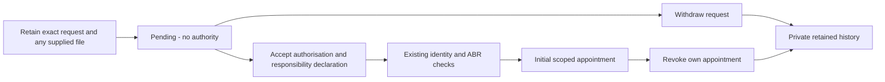

# Representative authority and company appointments

[Implementation index](README.md) · [Accepted plan](../../architecture/company-managed-registers.md)

Delivered under [#862](https://github.com/Ledova/ledova/issues/862); the final
foundation landed in [PR #911](https://github.com/Ledova/ledova/pull/911).
[#1020](https://github.com/Ledova/ledova/issues/1020) brings initial admission
into company signup on web and mobile, following the
[14 October decision](../../decisions.md#combined-company-signup-and-initial-authority).
[#1022](https://github.com/Ledova/ledova/issues/1022) simplifies that flow under
the owner's [same-day amendment](../../decisions.md#simple-signup-documents-and-team-after-registration).

Private authority requests, withdrawal and initial self-declaration admission
run on web and mobile. A pending request grants no authority. Admission records
the representative's declaration and an effective initial appointment for the
exact company, personal capabilities, delegatable scope and expiry. An
appointment supplies no approval of a share instruction, payment or director
decision; [company activation](company-activation.md) and the register
workflows in the [implementation index](README.md) use these appointments
through their own proposals and checks.

Company details are **provided by the company**. The existing ABR lookup checks
entity facts; it does not make Ledova responsible for company information or
establish the representative's mandate. Use synthetic people, companies and
evidence in this experimental implementation.

## Company signup

1. Create your account, verify its email and complete the existing profile and
   configured representative identity steps. Save the draft company at
   **Company details**, then continue to **Review**. Resuming signup reuses the
   saved profile and company.
2. Review the saved information. A short statement beside **Complete company
   setup** makes clear that choosing the button acknowledges your authority to
   administer this company's workspace, including its users, and accepts the
   linked Terms on its behalf. The Terms page shows version `2026-10-14`; company
   responsibilities are in the Terms. No file or separate authority/delegation
   checkbox is required.
3. Choose **Complete company setup** from **Review**. The action explicitly
   accepts the versioned declaration and retains the no-file authority
   request, admits that exact request through the existing identity and ABR
   checks, and completes signup only after the initial appointment is confirmed.
   A pending request or provider failure grants no authority. The appointment
   records personal `admin` and all six delegatable capabilities for subsequent
   team setup, together with the person, company, declaration version/text and
   admission time.
4. On the dashboard, use **Settings → Company documents** for relevant optional
   supporting files and **Settings → Team and appointments** to invite users.
   Mobile reaches the existing documents and team screens from **Settings →
   Company settings**. Actual uploads retain the checked private-file flow;
   later documents do not alter the immutable signup request.
5. Read the appointment's scope in company settings. The company remains Draft;
   registration neither incorporates a company with ASIC, appoints a director,
   activates it nor issues shares. Team invitations and register decisions are
   separate actions.

An unfinished account can sign in again to resume signup. Web company accounts
with saved personal details return to Company details with the saved company;
other accounts retain the existing account-type entry. A retry must resolve
the retained authority and current Terms outcome before completion; it cannot
infer success from a submitted request or a lost response.

A pending request is a proposal, not effective authority. If its personal scope
is not exactly `admin`, its delegation does not contain all six capabilities, or
it has an expiry, use **Update saved setup** before admission. That explicit
action withdraws the old proposal and permits a fresh request with the signup
defaults; it does not change an appointment.

If the person already has a current personal `admin` appointment for that
company, the final button uses it rather than another initial declaration.
Older, narrower and invited administrator appointments keep their original
declaration, capabilities, delegation and expiry. The action records current
Terms acceptance against that appointment when needed; an appointment that
already records the same acceptance supplies its existing receipt. It grants
no additional authority. Revoked, expired or ineffective appointments cannot
complete signup, and source failures withhold completion.

## Existing authority requests

1. Use your existing verified account and owned draft company. Complete the
   existing representative identity check when configured for companies.
2. Open **Representative authority** from the company details screen on web or
   mobile. Select the draft company you own; selection is explicit when you have
   several companies.
3. Choose personal capabilities and, separately, capabilities you intend to
   delegate. Initial admission requires personal `admin`. Set an expiry if
   required. Selecting scopes alone grants no authority.
4. Supporting PDF, PNG or JPEG is optional. An actual upload uses the checked
   private-file flow and remains retained; no ASIC extract is required. Files
   can instead be added later as company documents.
5. Submit the request. The platform freezes the company and representative
   identities, scopes, expiry and evidence bytes. Review the captured information.
6. Accept the displayed initial-company authority and Terms declaration and
   choose the admission action. Version `2026-10-14` records the workspace/team
   authority, acceptance of that Terms version on the company's behalf, and the
   company's responsibility for its information, ASIC filings and legal
   obligations. The existing configured identity and ABR checks must pass;
   missing or mismatched results leave the request pending. Admission does not
   activate the company.
7. Read the appointment's personal and delegatable capabilities, expiry and
   current status. An attached supporting file is available from request history;
   a no-file request has no downloadable file.
8. Withdraw an unwanted pending request. After admission, choose **Revoke
   appointment** and review the permanent loss of this appointment's company
   authority. Cancel to keep it, or confirm permanent revocation; its original
   declaration and evidence remain available. Another initial self-declaration
   cannot restore the appointment. Revocation does not admit a replacement
   representative or reopen initial admission.

Team invitations, acceptance, appointment history, administrator team reads and
revocation are available on web and mobile and through the API below.
Appointments created by the retired owner upgrade carry the legacy-owner source
described below.

## Web and mobile

Open **Company team** from company details, web **Settings → Profile and security**
or the mobile drawer. The settings/drawer entry is available to investor-only
accounts too; a company tab is not required to accept an invitation or read your
appointments.

1. To invite someone, select the company and one of your current delegating
   appointments. Select personal permissions and onward delegation separately,
   within that appointment's recorded delegation scope. Granting `admin` also
   requires a current personal `admin` appointment for that company. Optional
   appointment expiry and invitation deadline are explicit.
2. Create the invitation and privately share its displayed one-time code. The
   code is shown in the current form and disappears when the form is replaced or
   your account or selected appointment changes. It is not available from
   history. An unchanged interrupted retry keeps its idempotency key; a confirmed
   retry can return the retained invitation with no retrievable code. Create
   another invitation if you did not retain the code.
3. To accept, enter the code and agree to the displayed authorisation and company
   responsibility declaration. Your own account, verified email and configured
   identity checks apply. Editing the code clears agreement; failed acceptance
   retains the input for a deliberate retry.
4. Read your appointment's actual source, scope, expiry and current status. Read
   invitations you issued and their recorded acceptance outcome. These histories
   retain expired and revoked records. Current company administrators can also
   read the selected company's bounded team name, email, scope and status.
5. Revoke your own appointment or, as a current company administrator, a selected
   team appointment. Confirm the permanent action in the web dialog or native
   mobile alert. Cancelled, reused or stale confirmations cannot submit a new
   effect; a failed or unconfirmed result requires fresh confirmation. An initial
   or legacy-owner appointment cannot be replaced through another bootstrap
   declaration.

Refresh failures hide unavailable authority and team results. Account changes
invalidate pending submissions and late receipts. Company details are attributed
to the company; team access does not expose another person's private declaration,
identity/financial evidence or bootstrap file.

## API

`/api/v1/company-authority/requests/` provides authenticated JSON submission
without a file, checked multipart submission with an optional file, and paginated
personal history. Detail and file actions resolve only the caller's own request.
Active accounts with verified email are required. New submissions
also require current ownership of the selected draft company. Public company
visibility, shareholder records and platform staff permissions do not widen this
scope.

The server validates any upload and freezes raw and normalised identities,
file SHA256/size/type when supplied, requested scopes and expiry. A no-file request
retains empty file metadata and returns `file_url: null`; it does not create a
placeholder document. It accepts no caller-supplied
verification result or representative account. Identical submission retries under
the same requester-scoped idempotency key return the retained request, including
after its company leaves draft or changes owner. Retries compare incoming bytes,
filename, MIME type and terms with the retained digest and current identities;
they do not rescan already retained evidence. New keys require validation of any
supplied file and current draft-company ownership. Changed inputs conflict.

`POST /api/v1/company-authority/requests/{uuid}/admit/` requires
`declaration_version: "2026-10-14"` and `accept_declaration: true`. The server
checks the exact retained request, live requester and configured identity result,
current draft-company ownership, unchanged captured identities and unexpired
scope. It runs the existing ABR adapter under a separate authority purpose and
checks its genuine result for that company and lifecycle revision before creating
an immutable initial appointment. A provider failure supplies no appointment.
Repeated admission returns the retained outcome. A company has only one initial
admission; expiry or revocation does not permit a new bootstrap.

`POST /api/v1/company-authority/requests/{uuid}/withdraw/` accepts an empty body
and records immutable requester withdrawal. Admission and withdrawal share the
request lock. Whichever commits first excludes the other outcome.

`POST /api/v1/company-authority/requests/{uuid}/revoke/` accepts an empty body
and records immutable self-revocation of the admitted appointment. Repeated
revocation returns its original outcome. Reads and files remain available.
Current-authority checks reject revoked or expired appointments and inactive
accounts. Existing signed-transaction recovery is unaffected; no new chain or
register command is introduced here.

## Team invitation API

The following authenticated operations supplement the initial-request workflow:

| Operation                                                         | Scope and outcome                                                                                            |
| ----------------------------------------------------------------- | ------------------------------------------------------------------------------------------------------------ |
| `GET /api/v1/company-authority/invitations/`                      | Paginated history of invitations issued by the caller                                                        |
| `POST /api/v1/company-authority/invitations/`                     | Issue an invitation from the caller's selected current company appointment                                   |
| `POST /api/v1/company-authority/invitations/accept/`              | Accept a code with the exact current declaration, creating one appointment                                   |
| `GET /api/v1/company-authority/appointments/`                     | Paginated history of the caller's own initial, invited and legacy-owner appointments                         |
| `GET /api/v1/company-authority/appointments/team/?company={uuid}` | Read that company's team as a current company administrator                                                  |
| `POST /api/v1/company-authority/appointments/{uuid}/revoke/`      | Permanently revoke one's own appointment or, as a current administrator, another appointment in that company |
| `POST /api/v1/company-authority/appointments/{uuid}/signup-terms/` | Accept current signup Terms using one's current personal administrator appointment, preserving its authority |

The `signup-terms/` action requires `declarationVersion: "2026-10-14"` and
`acceptDeclaration: true`. It rechecks the caller's own exact-company personal
`admin` appointment, active email-verified account and bound profile, configured
identity requirement, expiry and revocation. It returns the own appointment with read-only
`signupTerms: {company, appointment, acceptedBy, acceptedProfile,
declarationVersion, declarationText, acceptedAt}`. The own-appointment list
exposes the same receipt, or `null` when this version has not been accepted.

For an initial appointment already carrying the exact current signup declaration,
the receipt comes from that original record and admission time. Otherwise the
action retains one immutable acceptance for that appointment/version, bound to
the person, profile, company, declaration and time. Repeated acceptance returns
the same receipt. It does not change the appointment, expand delegation, create
another bootstrap or restore ineffective authority. Reads and resuming the page
record no acceptance; only the explicit final action submits it.

Invitation issuance requires `company`, `inviter_appointment`, a caller-scoped
`idempotency_key`, and personal `capabilities`. Optional
`delegatable_capabilities` remain separate from personal authority. The union of
offered personal and delegatable capabilities must be within the selected
appointment's current delegatable scope. A caller may delegate a capability they
do not personally hold; this does not grant it to the caller. Granting or
delegating `admin` also requires a current personal `admin` appointment for
that company.

`acceptance_deadline` defaults to seven days and must be within thirty days.
Optional `appointment_expires_at` must be in the future. The issuance response
returns a random code once, with `Cache-Control: private, no-store`. The database
retains only its SHA256. Identical issuance retries return the original invitation
and `code: null`; changed company, source, scopes or explicit dates conflict. Send
the code directly to the intended recipient; it authorises the first eligible
accepting account. No email-delivery service or code-bearing URL is introduced.

Acceptance requires `code`, `declaration_version: "2026-10-04"` and
`accept_declaration: true`. It checks the actual accepting account and profile,
the configured company identity requirement, the invitation deadline and current
inviter authority before creating the exact offered appointment. An inviter cannot
accept their own invitation. A new acceptance also refuses an existing unrevoked,
unexpired appointment for the same person and company, even if that appointment
is temporarily ineffective. A new invitation can be accepted after the earlier
appointment expires or is revoked. No ABR check is fabricated for an invitation.
Concurrent acceptance creates one effect. The same accepting account's retry
returns its retained appointment, including after expiry or revocation; a
different account cannot consume it again. Revoking the inviter blocks a new
acceptance but does not revoke an already accepted child.

Self revocation remains available after loss of identity verification.
Administrators may revoke an initial or another administrator appointment; there
is no last administrator exception or new-bootstrap path. History remains
retained.

## What is recorded

An appointment names its appointee and their profile and has exactly one
initial-request, invitation or legacy-owner source. Initial admission records
the request's requester as the appointee, and a company has one such bootstrap
appointment. The app connection cannot create or alter these authority records
directly; database triggers protect admission, withdrawal, revocation and
immutable history.

`source: "legacy_owner"` marks appointments created by the retired owner upgrade
delivered with [PR #911](https://github.com/Ledova/ledova/pull/911). They carry
personal `admin` and the six delegatable capabilities, return null declaration
fields in the own-record API, and are subject to the same account, identity,
expiry and revocation checks. The fresh migration history creates none;
administrators appoint through invitations.

Supplied supporting files retain the [private-file lifecycle](../../architecture/files-and-retention.md).
Earlier admitted declarations keep their original version/text. Team invitation
acceptance and company activation retain their separate `2026-10-04` declaration;
a person accepting a limited invitation does not declare workspace administration.
An administrator's later current signup Terms acceptance is retained separately
as `CompanySignupTermsAcceptance` when the original appointment does not already
record it. Its actor, profile, company, appointment, version, text and time are
immutable; it grants no capabilities and does not rewrite the appointment history.

## Boundaries

Basic company PATCH and company-document upload, private-file reads and deletion
require current personal `admin` for that exact company or the draft setup
exception below; the [company information guide](company-information.md)
describes the client workflow. Initial, invited and legacy appointments use the
same live account, verified-email, configured identity, expiry and revocation
checks. Personal capabilities remain six independent values (`admin`,
`prepare`, `approve`, `apply`, `finance` and `read_register`); delegatable
scope supplies no basic administration. Company responses expose `is_owner` and
`administrative_access: {capabilities, draft_setup}`. Ownership is retained
relationship metadata for the owner workflows that keep their existing
conditions. PATCH returns the complete company detail, and document responses
include their read-only company UUID.

The draft setup exception: before a root exists, the current active,
email-verified owner can edit their draft and upload its documents. Any
retained initial appointment sourced by an admitted request, or any
legacy-owner source, permanently closes that exception. Revoked/expired roots,
hidden roots and later owner changes cannot reopen it. A pending request leaves
the draft editable so admission still checks its exact retained identity
snapshots against the current company.

Checks lock the company before the actor and affected rows and use the time
after lock waits; the connection roles, selectors and policies behind them are
described once in the [tenancy model](../../architecture/tenancy.md#roles-and-principal).
Share-class creation, offering, finance and publication authority keep their
existing owner and platform-staff checks; no delivered increment converts them.

Representative verification follows the owner's
[self-declaration decision](../../decisions.md#company-representative-verification),
which also rules out new fraud or impersonation checks without a cited legal duty.
