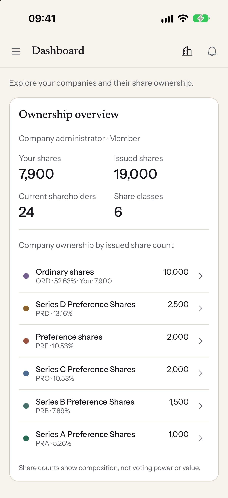
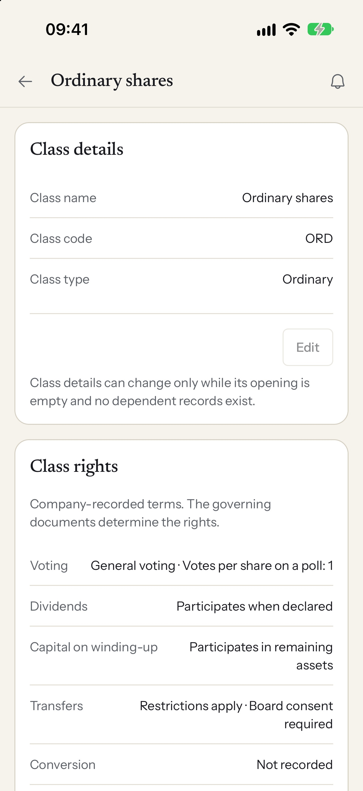
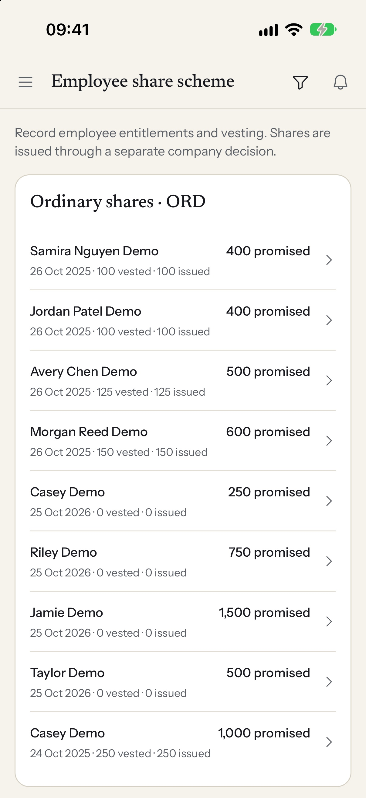
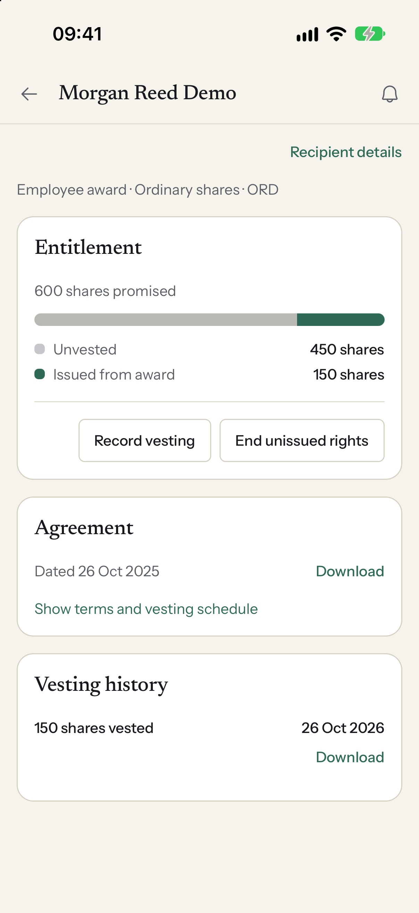
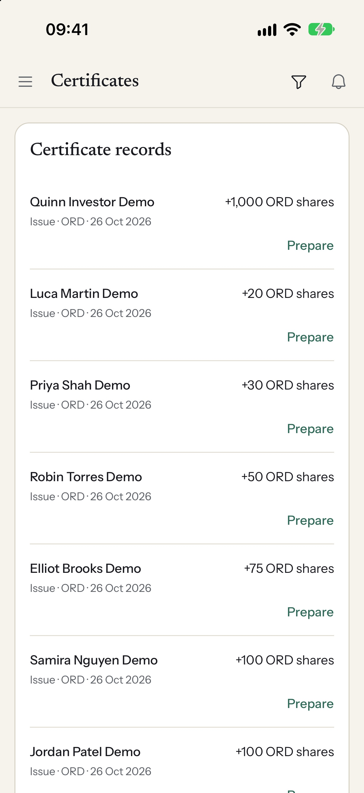

# App Store listing

[Mobile releases](../../docs/engineering/mobile-releases.md#app-store-listing) · [Documentation](../../docs/README.md)

What Ledova's iOS App Store page shows. This file and the screenshots beside it are the reviewed copy. App Store
Connect holds the live one, so a merged change here is then copied there by hand. App Review's sign-in, contact
details and notes stay in the private infrastructure repository.

**Status:** entered in App Store Connect on 20 November 2026 for version 1.0.4 with build 91. It has not been submitted
to App Review; [#1586](https://github.com/Ledova/ledova/issues/1586) sets the launch order.

## Product page

| Field | Value |
| --- | --- |
| Name | Ledova |
| Subtitle | Company ownership records |
| Icon | From the build: `mobile/assets/icon.png` |
| Primary category | Finance |
| Secondary category | Business |
| Support URL | https://ledova.io/contact |
| Marketing URL | https://ledova.io |
| Privacy policy URL | https://ledova.io/privacy-policy |
| Copyright | 2026 Blueberry Money Pty Ltd |
| Age rating | 4+ |
| Availability | Australia only |

### Promotional text

See who owns what in your private company. Keep share classes, shareholders and employee awards in one clear ledger, and give people access to their own records.

### Description

```text
Ledova gives Australian private companies a clear picture of who owns what, and gives shareholders and employees their own view of their shares and awards.

FOR COMPANIES
• See ownership by share class on the Dashboard.
• Set up your ledger: share classes, class rights and shareholders.
• Record company-approved share issues, transfers and corrections.
• Record employee share awards and their vesting. An award is an entitlement, not issued shares.
• Invite shareholders and team members, and choose what each person can see and do.
• Prepare share certificates, inspection copies and the company pack.

FOR SHAREHOLDERS AND EMPLOYEES
• See your shares and awards in each company that invites you.
• Follow your vesting and download available certificates.
• Keep your details up to date in your profile.

CLEAR BOUNDARIES
Ledova keeps the ownership records a company supplies and shows them to the right people. The company remains responsible for its legal register, approvals and filings; Ledova does not review or approve them. Ledova does not collect investment money, arrange trades, hold assets or give legal, financial or tax advice.

PRIVATE BY DEFAULT
Each person sees only what their role allows. We don't sell personal information or use it for advertising. You can delete your account in Settings.

Ledova is provided by Blueberry Money Pty Ltd.
Terms: https://ledova.io/terms-of-service
Privacy: https://ledova.io/privacy-policy
Questions: hello@ledova.io
```

### Keywords

```text
share register,cap table,shareholders,equity,employee share scheme,ESS,vesting,share certificates
```

## Privacy labels

Each data type is linked to the user's account, used only to run the app and not used for tracking.

| Data type | What it covers |
| --- | --- |
| Name | The account holder's name and the names a company records |
| Email Address | Sign-in, invitations and the addresses a company records |
| Phone Number | The phone number the app's sign-up asks for |
| Physical Address | The residential address the app's sign-up asks for, and recorded addresses |
| Other Financial Info | Shares, awards and the records behind them |
| Other User Content | Documents people upload |
| User ID | The account |
| Other Data Types | The date of birth the app's sign-up asks for |

## Screenshots

App Store Connect requires iPhone screenshots for its "iPhone with Dynamic Island (medium display)" slot, at
1206 × 2622 without transparency, and scales them down for smaller iPhones. These five show the local demo company,
whose names are fictional, in this order:

1. [Dashboard](screenshots/1-dashboard.jpg): the ownership overview.
2. [Share class](screenshots/2-share-class.jpg): Ordinary shares, with class details and rights.
3. [Employee share scheme](screenshots/3-employee-scheme.jpg): the employee awards.
4. [Award](screenshots/4-award.jpg): one award's entitlement and vesting.
5. [Certificates](screenshots/5-certificates.jpg): the certificate records.

<p>
  
  
  
  
  
</p>

How to retake them is in [mobile releases](../../docs/engineering/mobile-releases.md#app-store-listing).
